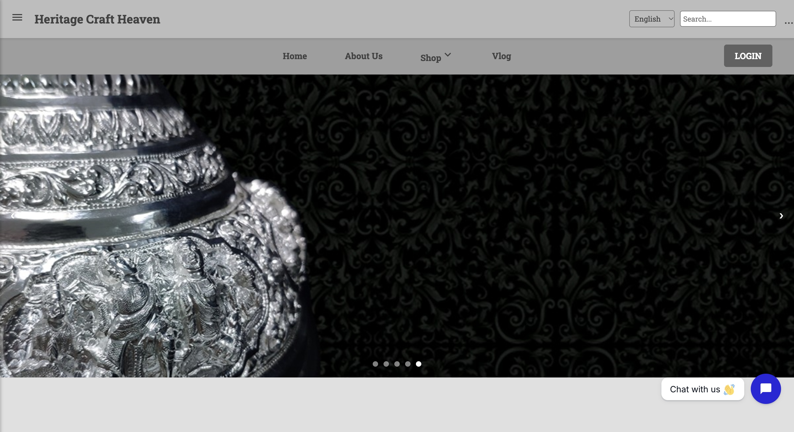
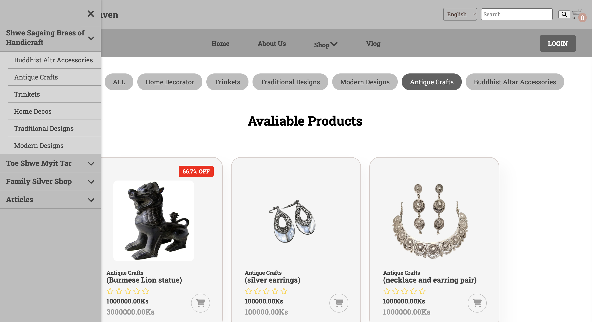
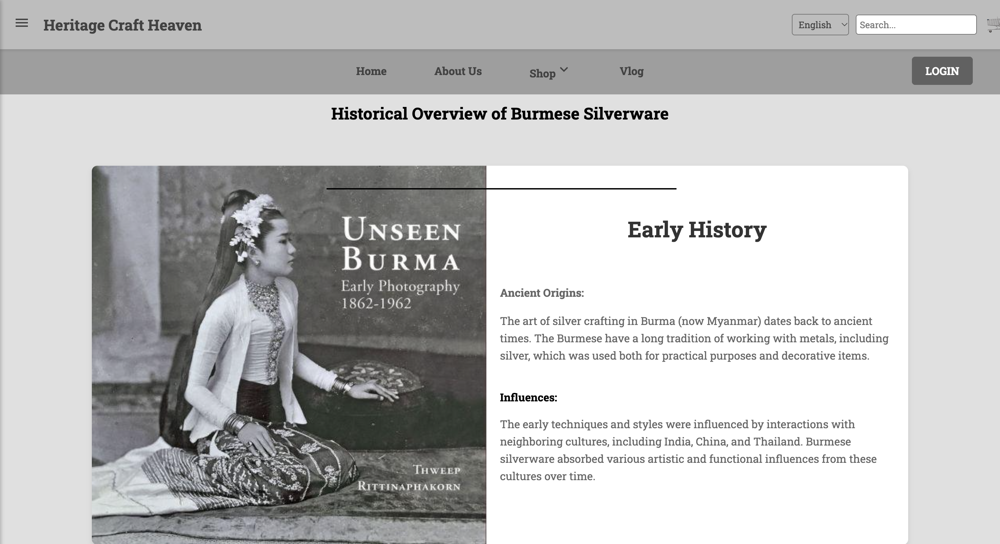

# Heritage Craft Haven 🏺

**Preserving Myanmar's traditional craftsmanship through a digital storefront.**

Heritage Craft Haven is a Django-based e-commerce web application concept that showcases Myanmar traditional handicrafts, including silverware, bronze wares, and Buddhist altar accessories. The project brings cultural heritage and traditional craftsmanship into an online shopping experience.

## ✨ Features

- **Product Catalogue** — Browse traditional Myanmar handicrafts.
- **Product Pages** — View product information and images.
- **User Accounts** — Registration and login functionality.
- **Shopping Experience** — Shopping cart and checkout interfaces.
- **Content Pages** — Explore information about traditional crafts and the project.
- **Django Admin** — Administrative interface for managing application data.

## 🖥️ Screenshots

### Home Page



### Shop Page



### About Us



## 🛠️ Tech Stack

- **Backend:** Python, Django
- **Frontend:** HTML, CSS, JavaScript
- **Database:** SQLite for local development, subject to the project's database configuration
- **Tools:** Visual Studio Code, Git, GitHub

## 📁 Project Structure

```text
Heritagecraftheavenbb/
├── Heritagecraftheaven/  # Django project configuration
├── home/                 # Homepage and related views
├── store/                # Store functionality
├── users/                # User-related functionality
├── templates/            # HTML templates
├── static/               # Static assets
├── media/                # Uploaded and product media
├── screenshots/          # Project screenshots
├── manage.py             # Django management utility
└── requirements.txt      # Python dependencies
```

## 🚀 Getting Started

### Prerequisites

- Python 3
- pip
- Git

### 1. Clone the repository

```bash
git clone https://github.com/ad0rab0nb0n/Heritage-Craft-Heaven.git
cd Heritage-Craft-Heaven
```

### 2. Create and activate a virtual environment

```bash
python3 -m venv .venv
source .venv/bin/activate
```

### 3. Install dependencies

```bash
python -m pip install --upgrade pip
pip install -r requirements.txt
```

### 4. Configure the application

Create a local `.env` file with the environment variables required by `Heritagecraftheaven/settings.py`. Keep your secret key and other private configuration out of version control.

### 5. Apply database migrations

```bash
python manage.py migrate
```

### 6. Create an administrator account

```bash
python manage.py createsuperuser
```

Follow the prompts to set up your account.

### 7. Run the development server

```bash
python manage.py runserver
```

Open **http://127.0.0.1:8000/** in your browser.

## 🎯 Project Goal

The goal of Heritage Craft Haven is to make traditional Myanmar handicrafts easier to discover online while presenting their cultural value through a dedicated digital shopping platform.

---

**Developed as a web development project using Django and Python.**